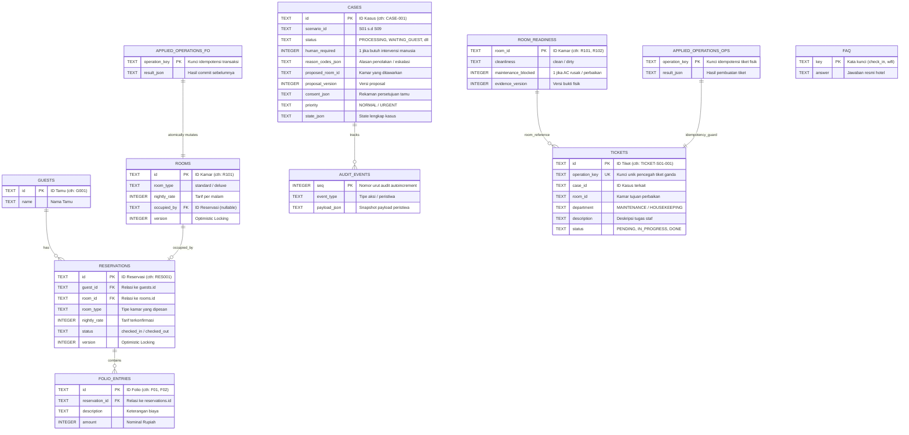

# Diagram Struktur Database Dual-Node SQLite
## ACE — Intelligent Mobile Agent System

Diagram relasi entitas (*Entity-Relationship Diagram*) berikut menunjukkan pemisahan dua basis data SQLite in-memory:
1. **Node FRONT_OFFICE**: Basis data untuk administrasi tamu, reservasi, tarif kamar, penagihan folio, dan status kasus.
2. **Node OPERATIONS**: Basis data operasional kamar fisik (kebersihan, blokir maintenance) dan tiket staf.

